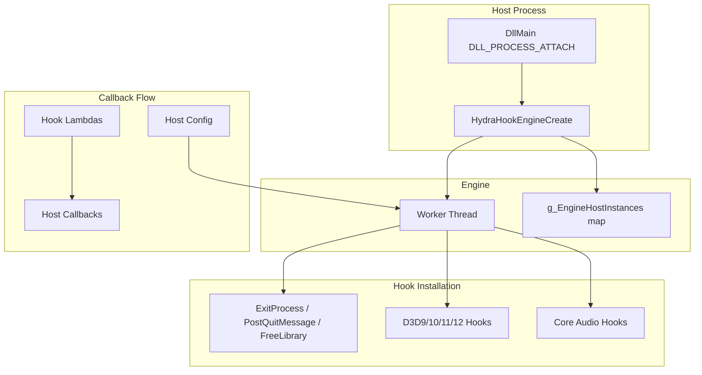

# HydraHook Internals

Developer-focused documentation for the HydraHook library. This document explains the architecture, components, and extension points for developers working on or integrating with HydraHook.

## Reference build

Doxygen 1.18.0 builds this document into the same HTML reference as the public headers and the C++ engine sources. The sidebar theme is Doxygen Awesome 2.5.0 (`docs/doxygen-awesome/`, MIT).

```text
doxygen Doxyfile
```

Open `docs/html/index.html`. Generated HTML is not committed. The class index is the C++ navigation, and source links are generated for the public headers and the engine. Mermaid diagrams render client-side from a pinned jsDelivr Mermaid release.

Published reference: <https://nefarius.github.io/HydraHook/>

`.github/workflows/docs.yml` runs the `Doxygen` check on pull requests and on pushes to `master`, including Markdown-only changes. Pull requests upload `docs/html`. Pushes to `master` publish that same output to GitHub Pages.

## Overview and Purpose

**HydraHook** is a Windows DLL that hooks Direct3D (9, 10, 11, 12) and Core Audio APIs in host processes. It is designed for injection into games and applications to intercept the render and audio pipelines.

**Typical use cases:**
- Overlays (e.g., ImGui-based UIs)
- Mods and enhancements
- Debugging and profiling tools
- Capture and recording utilities

**Design:**
- C API surface for host integration
- Microsoft Detours for function interception
- Configurable per-API enablement via `HYDRAHOOK_ENGINE_CONFIG`
- Pre/post callbacks for each hooked API

## Architecture



1. Host process loads HydraHook DLL (typically via injection).
2. `HydraHookEngineCreate` spawns a worker thread and registers the engine in `g_EngineHostInstances`.
3. Worker thread installs `ExitProcess`, `PostQuitMessage`, and `FreeLibrary` hooks for graceful shutdown, then D3D and Core Audio hooks based on config.
4. When the host calls hooked APIs, Detours redirects to hook lambdas, which invoke host callbacks before/after the original function.

## Directory Layout

| Path | Purpose |
|------|---------|
| `Engine.cpp` / `Engine.h` | Engine lifecycle, HMODULE mapping, logging, custom context, C API implementation |
| `Game/Game.cpp` / `Game.h` | Main hook worker thread, hook installation, shutdown handling |
| `Game/Shutdown.h` | `ShutdownOrigin` enum, `PerformShutdownCleanup` for consolidated pre-exit handling |
| `Game/Hook/` | Per-API vtable probing and hook targets (Direct3D9, Direct3D9Ex, Direct3D10/11/12, DXGI, AudioRenderClient) |
| `Utils/Hook.h` | Detours wrapper template (stdcall/cdecl, apply/remove/call_orig) |
| `Utils/Global.h` | `expand_environment_variables`, `process_name` |
| `CrashHandler.cpp` / `CrashHandler.h` | Ref-counted crash handler (SetUnhandledExceptionFilter, terminate, invalid_parameter, purecall); per-thread SEH translator |
| `Exceptions.hpp` | DetourException, ModuleNotFoundException, ARCException, etc. |

## Core Components

### Engine

**Files:** [Engine.cpp](Engine.cpp), [Engine.h](Engine.h)

- **`g_EngineHostInstances`**: Static map from `HMODULE` to `PHYDRAHOOK_ENGINE`. The map can hold more than one engine, but Detours hooks, `HookActivityTracker`, and the `HYDRAHOOK` spdlog logger are process-wide. One active hook worker per process is the supported case.
- **Engine creation**: `GetModuleHandleEx` with `GET_MODULE_HANDLE_EX_FLAG_FROM_ADDRESS | GET_MODULE_HANDLE_EX_FLAG_UNCHANGED_REFCOUNT` (the host DLL refcount is not incremented), `new HYDRAHOOK_ENGINE`, spdlog setup (`Logging.IsEnabled == FALSE` uses a null sink and does not open a file), `CreateEvent` for cancellation, `CreateThread` for `HydraHookMainThread`.
- **Engine struct fields**: `CrashHandlerInstalled`, `ShutdownCleanupDone`, `FreeLibraryHookActive` track shutdown state. `HookActivityTracker` provides lock-free in-flight callback counting for safe DLL unload.
- **Custom context**: `HydraHookEngineAllocCustomContext` allocates host-owned memory accessible from all event callbacks via `Extension->Context` or `HydraHookEngineGetCustomContext`.
- **Per-API callback tables**: `EventsD3D9`, `EventsD3D10`, `EventsD3D11`, `EventsD3D12`, `EventsARC` hold function pointers for pre/post hooks.

### Main Thread

**Files:** [Game/Game.cpp](Game/Game.cpp), [Game/Game.h](Game/Game.h)

- **`HydraHookMainThread`**: Entry point for the worker thread. Receives `PHYDRAHOOK_ENGINE` as `LPVOID`.
- **Flow**: Install ExitProcess/PostQuitMessage/FreeLibrary hooks -> Install D3D/Audio hooks (based on config) -> `WaitForSingleObject(EngineCancellationEvent)` -> Remove hooks -> `FreeLibraryAndExitThread` (unless shutdown was initiated by FreeLibrary hook).
- **DXGI (D3D10/11/12)**: D3D10, D3D11, and D3D12 share the same `dxgi.dll` `IDXGISwapChain` implementation. The worker probes D3D12 -> D3D11 -> D3D10 until the shared vtable addresses are resolved, installs one Detours hook per vtable slot (`Present`, `ResizeTarget`, `ResizeBuffers`, plus `IDXGISwapChain1::Present1` and `IDXGISwapChain3::ResizeBuffers1` when exposed), and dispatches per call via `chain->GetDevice(...)`. Hooks are detached in reverse (LIFO) installation order on shutdown.
- **D3D12**: Two capture paths for `ID3D12CommandQueue`:
  - **Early injection**: Hook `IDXGIFactory::CreateSwapChain` and `CreateSwapChainForHwnd` before the D3D12 probe (suppressing capture on the worker thread during its own temporary probes so concurrent game swap chains are still captured); `pDevice` is the command queue.
  - **Mid-process injection**: Hook `ID3D12CommandQueue::ExecuteCommandLists`; capture `D3D12_COMMAND_LIST_TYPE_DIRECT` device->queue mapping at runtime.

### Hook Template

**File:** [Utils/Hook.h](Utils/Hook.h)

- **`Hook<CallConvention, retn, args...>`**: RAII wrapper over Microsoft Detours.
- **Methods**: `apply(target, detour)`, `remove()`, `call_orig(...)`.
- **Transaction management**: `DetourTransactionBegin` / `DetourUpdateThread` / `DetourAttach` / `DetourTransactionCommit` (or `Abort` on failure).
- **Calling conventions**: `CallConvention::stdcall_t` and `CallConvention::cdecl_t`.

### Vtable Probers

**Directory:** [Game/Hook/](Game/Hook/)

- **D3D9Ex**: Creates a temporary hidden window via `Window`, loads `d3d9.dll`, calls `Direct3DCreate9Ex` -> `CreateDeviceEx` -> extracts vtable from the device. Used for both D3D9 and D3D9Ex hooks.
- **D3D10/11/12**: Check for already-loaded DXGI/D3D runtime DLLs via `GetModuleHandle` (they do not call `LoadLibrary`), then create a temporary factory/device/swap chain to extract the swap-chain vtable. If a runtime DLL such as `d3d12.dll` is not loaded in the process, its prober exits before any device creation attempt. Once the runtime DLL is available, the D3D11 and D3D12 probers try a hardware device and fall back to WARP when no usable hardware adapter exists. `IDXGISwapChain::Present` lives in `dxgi.dll`, so one hook per vtable slot covers D3D10, D3D11, and D3D12.
- **DXGI**: [DXGI.h](Game/Hook/DXGI.h) defines vtable indices (e.g. `Present = 8`, `ResizeBuffers = 13`, `ResizeTarget = 14`, `IDXGISwapChain1::Present1 = 22`, `IDXGISwapChain3::ResizeBuffers1 = 37`).
- **AudioRenderClient**: Uses MMDevice API (`IMMDeviceEnumerator` -> `IMMDevice` -> `IAudioClient` -> `IAudioRenderClient`) to obtain the vtable. Swap-chain probers fall back from `IDXGISwapChain3` to `IDXGISwapChain1` to `IDXGISwapChain` so `Present1` is still captured when `IDXGISwapChain3` is absent.

## Hooking Flow (Per Frame)

For a typical `IDXGISwapChain::Present` hook:

1. Host calls `IDXGISwapChain::Present`.
2. Detour redirects execution to the hook lambda.
3. **First call only** (`ResettableOnce`, shared by `Present` and `Present1` for the same API): Store the swap chain or device, set `GameVersion`, invoke `EvtHydraHookGameHooked`.
4. **Pre-callback** (if set): `EvtHydraHookD3D11PrePresent` with `HYDRAHOOK_EVT_PRE_EXTENSION` (engine handle, custom context).
5. **Original call**: `swapChainPresentHook.call_orig(chain, SyncInterval, Flags)`.
6. **Post-callback** (if set): `EvtHydraHookD3D11PostPresent` with `HYDRAHOOK_EVT_POST_EXTENSION`.
7. Return result to host.

## Shutdown Handling

To avoid DLL unload races and loader-lock issues, HydraHook hooks `ExitProcess`, `PostQuitMessage`, and `FreeLibrary`:

- **Shutdown.h**: `PerformShutdownCleanup(engine, ShutdownOrigin)` consolidates pre-exit handling. `ShutdownOrigin` can be `ExitProcessHook`, `PostQuitMessageHook`, `FreeLibraryHook`, `DllMainProcessDetach`, or `ManualUnhook`.
- **On trigger** (ExitProcess/PostQuitMessage/FreeLibrary): `EvtHydraHookGamePreExit` -> `SetEvent(EngineCancellationEvent)` -> `WaitForSingleObject(EngineThread, 6500)` so the wait outlasts the 5000 ms callback drain. `FreeLibrary` then detaches its own hook before `FreeLibraryAndExitThread`.
- **On FreeLibrary** (host-initiated unload): `PerformShutdownCleanup` runs, then `FreeLibraryAndExitThread` (engine thread does not call it again).
- **On DllMainProcessDetach**: No user callbacks; uses `remove_nothrow` to avoid loader-lock deadlocks. The wait is zero, and `HydraHookEngineDestroy` does not block on the lifecycle lock. It frees the engine only after the worker has exited, `HookActivityTracker::shutdown()` has run, and a current drain finds no in-flight callbacks. Otherwise it returns `HYDRAHOOK_ERROR_UNHOOK_INCOMPLETE`, keeps the engine, pins the worker's module with `GET_MODULE_HANDLE_EX_FLAG_PIN`, and suppresses `~Hook()` so CRT teardown after `DllMain` does not detach while that worker is still running. A detach caller cannot retry once the loader would have unmapped that module. The host-instance map lock is taken with `try_lock`.
- **On ManualUnhook** (`HydraHookEngineUnhook`): `PerformShutdownCleanup` skips `EvtHydraHookGamePreExit`, sets `SkipDllUnloadOnExit`, signals the worker, and waits up to 8000 ms. The worker removes every hook (including `ExitProcess`/`PostQuitMessage`/`FreeLibrary`) with `remove_nothrow`, drains, runs the unhook callbacks, and exits with `ExitThread` so the DLL stays loaded.
- **Main thread**: Wakes from `WaitForSingleObject`, invokes `EvtHydraHookGamePreUnhook`, removes all hooks, invokes `EvtHydraHookGamePostUnhook`, then `FreeLibraryAndExitThread(engine->HostInstance, 0)` (unless `FreeLibraryHookActive`).

## Unhook and Rehook

`HydraHookEngineUnhook(Engine)` and `HydraHookEngineRehook(Engine)` run a hook, unhook, rehook cycle in one loaded DLL. Neither may be called under the loader lock, from a hook callback, or from the worker thread.

- **Unhook**: runs the ManualUnhook shutdown above and never calls `TerminateThread`. It waits for the worker to exit (also when another shutdown path already claimed cleanup) and for in-flight callbacks to drain; if either fails it returns `HYDRAHOOK_ERROR_UNHOOK_INCOMPLETE` and keeps the worker handle and state so it can be retried. On success it closes the worker handle and clears the render pipeline pointers and `GameVersion`. It is idempotent.
- **Rehook**: calls `HookActivityTracker::reset()`, clears `ShutdownCleanupDone`, `FreeLibraryHookActive` and `SkipDllUnloadOnExit`, resets the cancellation event, restores `Events*` from `SavedEvents*`, and starts a new `HydraHookMainThread`. It is a no-op while a worker is running.
- **Callback tables**: `HydraHookEngineSet*EventCallbacks` writes both the live table and a saved copy. The worker zeroes the live tables on unhook; rehook restores the saved copies before `EvtHydraHookGameHooked` fires again.
- **Announcements**: the once-per-hook announcements are `ResettableOnce` members of `g_announce` in `Game.cpp`. The worker re-arms all of them and the engine pointer at the start of each run.
- **Serialization**: `LifecycleLock` (SRW lock in the engine struct) serializes unhook and rehook.

## Build Configuration

- **Output**: DLL (Debug/Release) or static library (Debug_LIB/Release_LIB). See [HydraHook.vcxproj](HydraHook.vcxproj).
- **Static library is the easier injection route**: linking it into the host DLL embeds the engine, so a single DLL is injected and no separate `HydraHook.dll` must be deployed or loaded. The DLL configurations suit consumers that want a shared engine binary.
- **Preprocessor defines** to exclude APIs:
  - `HYDRAHOOK_NO_D3D9`
  - `HYDRAHOOK_NO_D3D10`
  - `HYDRAHOOK_NO_D3D11`
  - `HYDRAHOOK_NO_D3D12`
  - `HYDRAHOOK_NO_COREAUDIO`
- **Dependencies**: vcpkg (spdlog, detours).
- **Public headers**: `include/HydraHook/Engine/` (HydraHookCore.h, HydraHookDirect3D9.h, HydraHookDirect3D10.h, HydraHookDirect3D11.h, HydraHookDirect3D12.h, HydraHookCoreAudio.h).

## Testing

`tests/cpp/` builds three projects, wired into `HydraHook.slnx` under the `tests` folder. They build with the `Debug_LIB` and `Release_LIB` solution configurations and link the static library (the smoke host does; the smoke runner loads that host).

- `HydraHookTests` covers the C API init helpers, engine handle and custom-context checks (null config, null context, logging disabled), `Hook` apply/remove/`remove_nothrow` including a rejected second apply, `HookActivityTracker`, utility functions (environment expansion does not keep a trailing NUL), exception types, crash-handler refcounting and snapshot promotion, the per-thread SEH translator, `FrameRate`, and the ImGui sample's `ResettableInitGuard` (once-only init, reset, retry-on-failure, concurrent callers) and `WindowProcHook` (validation, forwarding, destroy cleanup, external subclass chaining, re-entrancy, cross-thread hook churn). `HookActivityTracker::reset`, `ResettableOnce`, `Hook` re-apply, and the `HydraHookEngineUnhook`/`HydraHookEngineRehook` handle checks are covered too. No test exercises a real game hook/unhook/rehook cycle; the WARP smoke test covers a synthetic D3D11 one.
- `HydraHookTestHost` is a small DLL that enables D3D10/D3D11/D3D12 hooking and exports shared counters plus the engine `GameVersion`.
- `HydraHookWarpSmokeTests` loads `d3d12.dll` alongside `d3d11.dll`, creates a hidden window and a `D3D_DRIVER_TYPE_WARP` device, loads the host, and asserts the game-hooked callback, `GameVersion`, Present, Present1 (no second announcement), and ResizeBuffers callbacks. It then runs a full cycle on the same DLL and swap chain: `HydraHookEngineUnhook` (pre/post-unhook callbacks fire once, the DLL stays loaded, Present and ResizeBuffers still succeed without firing callbacks, a second unhook is a no-op), then `HydraHookEngineRehook` (the game-hooked callback fires again and Present and ResizeBuffers callbacks resume). Finally it calls `FreeLibrary` from a worker thread so the FreeLibrary hook can unload the DLL.

## Extending HydraHook

### Adding a New D3D Version

1. Add a vtable prober class in `Game/Hook/` (e.g. inherit from `Direct3DBase` or follow the DXGI pattern).
2. Add hook installation in `Game.cpp` inside the appropriate `#pragma region`.
3. Add callback struct and `HydraHookEngineSetD3D*EventCallbacks` in `include/HydraHook/Engine/`.
4. Add `EventsD3D*` and `INVOKE_D3D*_CALLBACK` macro in [Engine.h](Engine.h).

### Adding a New Hook Target

1. Declare a `Hook<>` instance (static in `HydraHookMainThread`).
2. Obtain the target address (vtable index or exported function).
3. Call `hook.apply(target, lambda)` with a lambda that invokes pre/post callbacks and `call_orig`.
4. Register the callback in the engine config and callback struct.

### Custom Context

- Call `HydraHookEngineAllocCustomContext` before hooks run (e.g. in `EvtHydraHookGameHooked`).
- Access from callbacks via `HydraHookEngineGetCustomContext(Engine)` or `Extension->Context` in D3D11/12/ARC callbacks.
- Free with `HydraHookEngineFreeCustomContext` before engine destroy.

## Exception Handling

| Exception | Cause |
|-----------|-------|
| `DetourException` | Detours API failures (attach/detach, transaction errors, target too small) |
| `ModuleNotFoundException` | Required DLL not loaded (e.g. d3d9.dll) |
| `ProcAddressNotFoundException` | GetProcAddress failed |
| `ARCException` | Core Audio COM failures (HRESULT) |
| `DXAPIException` | DirectX COM failures (HRESULT) |

All are caught in `Game.cpp` with `logger->error` or `logger->warn`; the engine continues and skips the failed API.

## File Reference

| File | Description |
|------|-------------|
| [Engine.cpp](Engine.cpp) | C API implementation: create, destroy, context, callbacks, logging |
| [Engine.h](Engine.h) | Internal engine struct, callback invocation macros, HookActivityTracker |
| [Game/Game.cpp](Game/Game.cpp) | Main thread: hook installation, shutdown, D3D/Audio wiring |
| [Game/Game.h](Game/Game.h) | `HydraHookMainThread` declaration, `GetD3D12CommandQueueForSwapChain` |
| [Game/Shutdown.h](Game/Shutdown.h) | `ShutdownOrigin`, `PerformShutdownCleanup` |
| [Utils/Hook.h](Utils/Hook.h) | Detours `Hook<>` template |
| [Utils/Global.h](Utils/Global.h) | Environment expansion, process name |
| [CrashHandler.cpp](CrashHandler.cpp), [CrashHandler.h](CrashHandler.h) | Crash handler install/uninstall, per-thread SEH |
| [Exceptions.hpp](Exceptions.hpp) | Exception types |
| [Game/Hook/Direct3DBase.h](Game/Hook/Direct3DBase.h) | Abstract base for D3D vtable probers |
| [Game/Hook/Direct3D9.h](Game/Hook/Direct3D9.h) | D3D9 vtable indices |
| [Game/Hook/Direct3D9Ex.h](Game/Hook/Direct3D9Ex.h), [.cpp](Game/Hook/Direct3D9Ex.cpp) | D3D9Ex prober |
| [Game/Hook/Direct3D10.h](Game/Hook/Direct3D10.h), [.cpp](Game/Hook/Direct3D10.cpp) | D3D10 prober |
| [Game/Hook/Direct3D11.h](Game/Hook/Direct3D11.h), [.cpp](Game/Hook/Direct3D11.cpp) | D3D11 prober |
| [Game/Hook/Direct3D12.h](Game/Hook/Direct3D12.h), [.cpp](Game/Hook/Direct3D12.cpp) | D3D12 prober |
| [Game/Hook/DXGI.h](Game/Hook/DXGI.h) | IDXGISwapChain vtable indices |
| [Game/Hook/Window.h](Game/Hook/Window.h), [.cpp](Game/Hook/Window.cpp) | Temporary window for D3D device creation |
| [Game/Hook/AudioRenderClientHook.h](Game/Hook/AudioRenderClientHook.h), [.cpp](Game/Hook/AudioRenderClientHook.cpp) | Core Audio prober |
